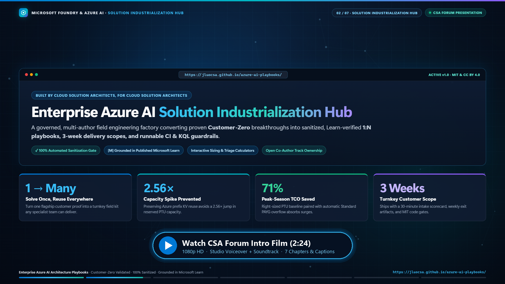

# Enterprise Azure AI Architecture Playbooks

Live Hub: **<https://jluocsa.github.io/azure-ai-playbooks/>**

A governed, multi-author field playbook hub that converts **Customer-Zero** Azure AI and Microsoft Foundry architecture engagements into **repeatable engineering patterns, readiness gates, and scopable delivery kits**.

Built with [VitePress](https://vitepress.dev/), enforced by an automated pre-publication sanitization gate (`scripts/check-sanitized.mjs`), zero-dependency `PCR001–006` CLI linting (`docs/public/kits/pcr_lint.py`), and print-ready Markdown white-paper subpages (`@media print`).

## CSA Forum Introduction Film (2:24 · 1080p HD with Studio Voiceover)

<video controls playsinline preload="metadata" poster="./docs/public/video/azure-ai-playbooks-csa-forum-intro-poster.png" width="100%">
  <source src="./docs/public/video/azure-ai-playbooks-csa-forum-intro.webm" type="video/webm" />
  <source src="./docs/public/video/azure-ai-playbooks-csa-forum-intro.mp4" type="video/mp4" />
  <a href="https://jluocsa.github.io/azure-ai-playbooks/#csa-forum-video" title="Watch the 2:24 CSA Forum Studio Introduction Film with Voiceover, Chapters & Captions">
    
  </a>
</video>

> **▶ Watch Online with Sound:** [**Open Interactive Hub Cinema Player (7 Chapters + Captions)**](https://jluocsa.github.io/azure-ai-playbooks/#csa-forum-video) &middot; [**Stream / Download 1080p MP4 (PowerPoint & Teams)**](https://jluocsa.github.io/azure-ai-playbooks/video/azure-ai-playbooks-csa-forum-intro.mp4) &middot; [**Stream 1080p WebM (VS Code & Browsers)**](https://jluocsa.github.io/azure-ai-playbooks/video/azure-ai-playbooks-csa-forum-intro.webm)

## Why This Hub Exists

1. **1:N Architectural Leverage:** One deep Customer-Zero engagement sets a verified engineering bar reusable across specialist teams and enterprise accounts without re-deriving cross-service answers under cutover pressure.
2. **Cutover & Capacity Risk Protection:** Readiness gates (`C1–C15`), two-regime PTU math, and APIM spillover patterns prevent latency regressions, HTTP `429` storms, and stalled rollouts during model retirement waves.
3. **Solution Industrialization Factory:** Standardizes the pipeline from *Customer-Zero Validation → Sanitization Gate → Architecture Review → IP / Product Group / Playbook Disposition*.
4. **Governed Field-to-Product Pathway:** Routes field discoveries cleanly toward Product Group feedback, Azure Architecture Center pull requests, or prior-art-safe IP review before publication.
5. **Scopable Delivery Accelerators:** Pairs every playbook with an intake qualification scorecard, a 3-week readiness engagement blueprint, static CI rules, eval contracts, and Application Insights KQL gates.

## Repository Structure

```text
azure-ai-playbooks/
├─ docs/
│  ├─ .vitepress/
│  │  ├─ config.mts                  # Site config, path-scoped sidebars & local search
│  │  └─ theme/                      # Executive styling, @media print, <PlaybookMeta /> & <PtuCalculator />
│  ├─ operating-model/               # Industrialization pipeline, governance & 3-week delivery scope
│  ├─ playbooks/
│  │  ├─ prompt-caching/             # Playbook 01 (Live): GPT-5.6+ Prompt Caching, PTU & Regulated Multi-Engagement Profile
│  │  └─ series-charters/            # Playbooks 02 & 03: Scoped charters open for co-author leads
│  ├─ papers/                        # Single-page Markdown white paper, inline kits & PR checklist subpages
│  └─ public/
│     ├─ kits/                       # Runnable pcr_lint.py CLI & ptu-cache-release-gate.kql
│     └─ video/                      # 1080p CSA Forum studio intro MP4, poster PNG & synchronized WebVTT
├─ scripts/
│  ├─ build-intro-video.mjs          # Deterministic 1080p studio video, neural VO, ambient score & VTT builder
│  ├─ check-sanitized.mjs            # Blocks customer names, internal terms, emails & GUIDs
│  └─ deploy-gh-pages.mjs            # Runs sanitization + VitePress build & publishes to gh-pages
├─ CONTRIBUTING.md                   # Co-authoring workflow & 3-gate pre-publication checklist
└─ .github/
   ├─ CODEOWNERS                     # Per-playbook track ownership
   ├─ pull_request_template.md       # Sanitization, ARB & IP disposition attestation
   └─ workflows/deploy.yml           # Sanitization check -> CLI lint smoke -> VitePress build -> Pages
```

## Local Development & Verification

```bash
npm install
npm run verify            # Run check:sanitized + production VitePress build
npm run video:build       # Re-synthesize neural voiceover, ambient score, VTT & 1080p MP4
npm run docs:dev          # Start local VitePress dev server
npm run deploy:pages      # Verify sanitization, build static site, and push to origin/gh-pages
```

## Publishing to GitHub Pages

1. Initialize a clean Git repository from this directory (`git init` — never import history from private customer repositories).
2. If deploying at a root domain (`<owner>.github.io`), set `VITEPRESS_BASE=/`; for a project subpath (`<owner>.github.io/<repo>/`), the default `/azure-ai-playbooks/` base applies automatically.
3. Run `npm run deploy:pages` to publish directly to the `gh-pages` branch (or push to `main` when GitHub Actions runners are enabled).

> **Disclaimer:** Community architecture guidance grounded in public Microsoft Learn documentation. Personal/community views of the contributors; not official Microsoft product documentation or contractual SLA guidance.
