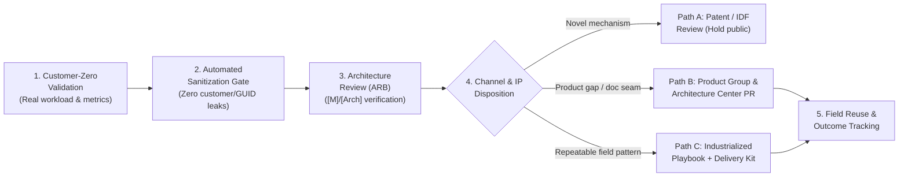

# 01 · Solution Industrialization Pipeline

Enterprise AI architecture specialists regularly solve complex, cross-service production problems for a single flagship account (**Customer-Zero**)—only for those exact same migration, capacity, and resiliency problems to recur across dozens of other enterprise accounts weeks later.

This hub provides the **Solution Industrialization mechanism** that converts bespoke 1:1 engagement artifacts into **governed, repeatable 1:N engineering assets**.

## Five Strategic Value Pillars

| Strategic Pillar | Operational Problem Solved | Mechanism in This Hub |
| :--- | :--- | :--- |
| **1. Convert Specialist Coverage into 1:N Leverage** | When specialist architects are spread thinly across many enterprise portfolios, bespoke per-account white papers do not scale. | One deep Customer-Zero engagement establishes a peer-reviewed reference playbook, KQL gate, and CI lint spec reusable across every peer team. |
| **2. Protect Production Workloads During Model Retirement Waves** | Model retirements (`gpt-4.x`, `o3-mini` &rarr; `gpt-5.6`, `gpt-6`, `gpt-6.1`) stall when teams hit `0%` cache hits, `2.56×` PTU spikes, or HTTP `429` storms. | Standardized [`C1–C15` readiness gates](/playbooks/prompt-caching/govern/14-readiness-standard), two-regime PTU math, and SKU-aware APIM spillover make every cutover predictable. |
| **3. Operationalize Solution Industrialization** | Field IP often stays trapped in slide decks or customer-specific PDFs that cannot be shared across accounts. | Automated sanitization (`check-sanitized.mjs`) + dual **Interactive Web Playbook + 16-Page Executive PDF** packaging make field IP turnkey. |
| **4. Governed Field-to-Product Innovation Pathway** | Ad-hoc external sharing risks either leaking customer context or inadvertently creating prior art on patentable mechanisms. | Every candidate clears a structured **Sanitization + Architecture Review + Tri-Path Disposition Gate** (IP Hold vs. Product Group/Learn Upstream vs. Field Playbook). |
| **5. Scopable Proactive Delivery Assets** | Proactive readiness engagements require clear intake criteria, bounded timelines, and concrete exit artifacts to scope consistently. | Every playbook ships with an [Intake Qualification Scorecard & 3-Week Delivery Blueprint](/operating-model/delivery-scoping). |

## The Five-Stage Industrialization Factory

### Stage-by-Stage Operating Rules

1. **Customer-Zero Validation:** A candidate pattern is eligible only after its math, wire payloads, and operational gates have been exercised against a real enterprise architecture (never drafted purely by paraphrasing documentation).
2. **Automated Sanitization Gate (`npm run check:sanitized`):** Strips all customer identifiers, application names, stakeholder names, engagement dates, internal organization/sales acronyms, and tenant/subscription GUIDs across Markdown, HTML, KQL, and rendered PDFs.
3. **Peer Architecture Review (ARB):** Verifies every product statement against published Microsoft Learn documentation ([M]) and separates product facts from recommended CSA patterns ([Arch]) and proposed release SLOs ([Agree]).
4. **Tri-Path IP & Channel Disposition:**
   - **Path A — Patent / Invention Disclosure Hold:** Novel algorithms or system mechanisms with non-obvious technical distinctions are routed confidentially for IP evaluation *before* any public commit (preventing accidental prior-art disclosure).
   - **Path B — Product Group & Official Docs Upstream:** Service-boundary gaps, telemetry seams, and cross-service reference architectures are packaged as concise Product Group engineering briefs or pull requests into Microsoft Learn / Azure Architecture Center.
   - **Path C — Industrialized Field Playbook:** Cross-service readiness standards, sizing calculators, static CI linters, and KQL workbooks publish into this hub (internal channel first; public mirror as an approved amplification step).
5. **Multi-Account Delivery & Outcome Tracking:** Peer architects apply the playbook in Architecture Design Sessions (ADS) and structured 3-week readiness engagements, recording concrete engineering outcomes.
