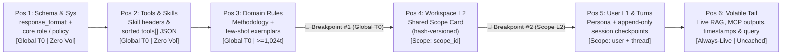

# 07 · Scope × Volatility Prefix Architecture

Enterprise agent context divides cleanly along two orthogonal axes [Arch]:

- **Axis A — Scope:** `Global` (all users & workspaces) &rarr; `Workspace / Case` (`scope_id`) &rarr; `User / Thread` (`user_id`, `thread_id`).
- **Axis B — Volatility:** `Static Release (T0)` &rarr; `Low/Medium Scoped Card (L2 / L1)` &rarr; `Always-Live RAG & MCP Tail`.

Mapping those two axes onto **Prompt Positions 1–6** maximizes KV-cache reuse across *both* concurrent users and multi-turn sessions.

## Six-Position Prompt Prefix Pipeline [Arch]

## Context Category Mapping Table [Arch]

| Pos | Context Category | Source Layer | Volatility / Scope | GPT-5.6+ Caching & Breakpoint Rule |
| :--- | :--- | :--- | :--- | :--- |
| **1** | **Structured schema & core system instructions** | Release config (`response_format` + system prompt) | Zero (per release) / Global | Byte-identical across all calls to the node/skill. Strip all timestamps, user IDs, and request GUIDs. |
| **2** | **Skill catalog & tool schemas** (`tools[]`) | Container image `T0` + MCP tool registry | Zero (per release) / Global | Sort tool array by name; serialize JSON schemas with `sort_keys=True` so wire bytes never drift across pods. |
| **3** | **Domain methodology & reference exemplars** | Container image `T0` static reference packs | Low / Global | Mount static domain methodology, rubric definitions, and few-shot exemplars here. **Place Breakpoint #1 (`>=1,024t`) at end of Pos 3.** |
| **4** | **Workspace / case context card (`L2`)** | Application DB / workspace state store | Low–Med / `(scope_id)` | Schema-constrained JSON card for the active workspace/case (versioned by content hash). **Place Breakpoint #2 here** when batching calls per workspace. |
| **5** | **User persona (`L1`) & session history** | Profile store + session checkpoint store | Med / `(user_id, thread_id)` | Inject compact `L1` preferences followed by append-only checkpointed turns (enables in-session hits via the `implicit` latest-message breakpoint). |
| **6** | **Retrieved RAG chunks & live MCP outputs** | Azure AI Search, vector stores, live APIs | **High (Always-Live)** | Fetch live at use-time and place at the prompt tail alongside the current user question. **Never place a breakpoint after Pos 6.** |

::: tip Context Precedence Without Breaking the Prefix
Declare static precedence instructions (*"Workspace scope `L2` governs domain constraints; User `L1` governs output formatting"*) in **Position 1**, while keeping the actual `L2` and `L1` payloads in **Positions 4 and 5**.
:::
