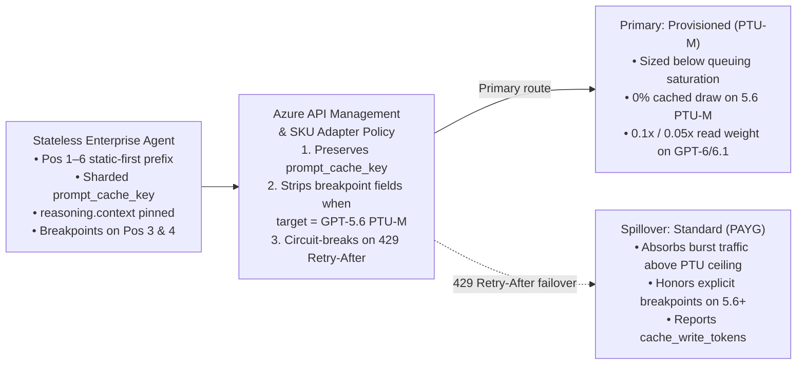

# 10 · APIM SKU-Aware PTU-to-Standard Spillover

Rolling 30-day PTU right-sizing works best when base **Global / Data Zone PTU-M** capacity is sized for steady sustained demand (staying below `~60–70%` queuing saturation) and paired with automatic **Standard (PAYG) spillover** via Azure API Management (APIM) on HTTP `429` [Arch].

## SKU-Aware Gateway Routing Topology [Arch]

## Critical Gateway Rules When Mixing GPT-5.6 PTU-M & Standard

1. **Preserve `prompt_cache_key` across both legs:** Keep the exact sharded `prompt_cache_key` unchanged when failing over from PTU-M to Standard so repeated spillover requests still group onto the same Standard cache partition.
2. **Strip unsupported breakpoint fields on the GPT-5.6 PTU-M leg:** Because GPT-5.6 PTU-M does not support `prompt_cache_breakpoint` or `prompt_cache_options` [M] (whereas GPT-5.6 Standard and GPT-6+ PTU-M do), let the gateway adapter strip those fields when forwarding to a GPT-5.6 PTU-M backend while leaving them intact on Standard spillover and GPT-6+ PTU-M.
3. **Bound retries & honor `Retry-After`:** Open the primary backend's circuit breaker for the returned `Retry-After` duration on HTTP `429`, route burst calls cleanly to Standard, and never replay mid-stream SSE failures.
