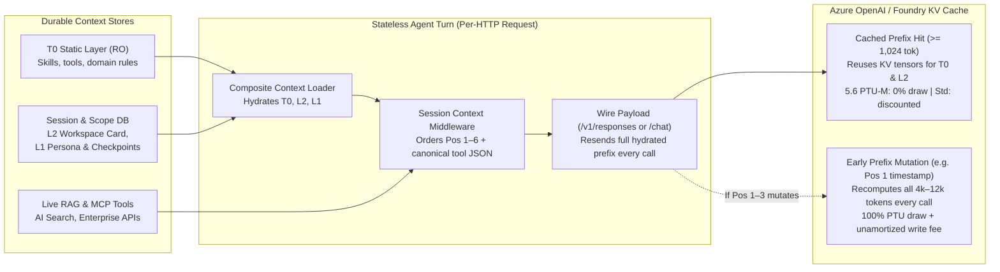

# 02 · Stateless Agent Runtimes & the Hydration Tax

Production enterprise agent platforms follow a **Model 2 stateless web backend pattern** (constructed and torn down on every HTTP request) rather than a **Model 1 stateful local CLI process** (resident in memory across turns) [Arch].

Each turn hydrates three context tiers and transmits the full prompt over the wire:

- **`T0` (Global Static Layer):** Read-only system policies, skill headers, sorted tool schemas, and domain methodology mounted in the container image.
- **`L2` (Workspace / Case Context Card):** Shared engagement, project, or tenant scope facts loaded from the application database.
- **`L1` (User Persona & Session Checkpoints):** Operator preferences and append-only conversation turns rehydrated by `thread_id`.

## Per-Turn Hydration vs. Azure OpenAI KV Prefix Cache

## Model 1 (Stateful Local CLI) vs. Model 2 (Stateless Enterprise Backend) [Arch]

| Runtime Property | Model 1 — Stateful Local Agent (CLI) | Model 2 — Stateless Enterprise Backend (Container Service) |
| :--- | :--- | :--- |
| **Process & state lifetime** | Long-lived process; local disk and in-memory state remain warm across the session. | **Constructed and destroyed per turn:** Each HTTP request executes one turn and tears down; no state survives in process memory between turns. |
| **Skills & domain rules** | Local skill files and prompt templates loaded once at startup. | **Container image & registry mounts (`T0`):** Static system policies, skill definitions, and domain rubrics assembled into the prompt on every turn. |
| **Context hydration** | Cumulative transcript stays resident in local process memory. | Rehydrated per request from durable session checkpoints (by `thread_id`) + scoped **Workspace (`L2`)** and **User (`L1`)** context records. |
| **Token & PTU cost model** | Static context reads amortize across the local process lifetime. | **Every LLM call pays a hydration tax over the wire** unless the assembled prompt prefix hits the **Azure OpenAI KV Prefix Cache**. |

::: tip Core Architectural Insight
Because a stateless backend rehydrates and resends system instructions, skill catalogs, tool schemas, domain methodology, and checkpointed history on *every single LLM call*—and a single user turn in a multi-node review graph invokes the LLM **3 to 8 times**—**Azure OpenAI prompt caching is the stateless backend's cross-turn memory**. Preserving byte-identical prefix ordering across turns is an architectural invariant, not a micro-optimization.
:::
