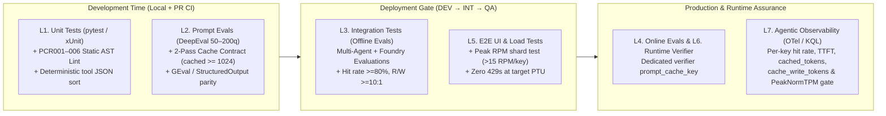

# 11 · 7-Layer Quality Pipeline & 7-Step Protocol

Rather than creating a separate governance silo, prompt-caching and PTU readiness plug directly into a defense-in-depth **7-Layer Testing & Quality Strategy** spanning Development Time (Layers 1–2), Deployment Gates (Layers 3 & 5), and Production Assurance (Layers 4, 6 & 7) [Arch].

## 1. Seven-Layer Quality Integration Matrix [Arch]

| Quality Layer | Reference Test Stack & Scope | Added GPT-5.6+ Migration & Caching Gate |
| :--- | :--- | :--- |
| **1. Unit Tests** (Local + PR CI) | `pytest` (Python) / `xUnit` (.NET); deterministic assertions on serialization & routing. | Run **`PCR001–PCR006` static AST/regex linter**; assert deterministic `tools[]` sorting, static `response_format`, and zero timestamps in Pos 1–3. |
| **2. Prompt Evals** (Local + PR CI) | `pytest` + DeepEval / Foundry Evals (`GEval`, structured-output & tool metrics) on 50–200 golden cases. | Parametrize candidate model with a **2-pass execution**: Pass 1 warms cache; Pass 2 asserts `cached_tokens >= 1024` and quality parity. |
| **3. Integration Tests** (`DEV -> INT -> QA`) | Integration runners + `Azure AI Foundry Evaluations` SDK across multi-step agent graphs. | Verify multi-turn scenarios keep append-only history and achieve **`>=80%` repeat hit rate** and **`>=10:1` read/write ratio** [Agree]. |
| **4 & 6. Online Evals & Runtime Verifier** | Sampled production scoring (privacy-masked) + runtime groundedness verifier nodes. | Assign runtime verifier nodes a dedicated sharded `prompt_cache_key` so verification calls never thrash generator cache slots. |
| **5. End-to-End & Load** (`LOAD` env) | Playwright UI + load generator exercising peak release concurrency. | Test above `~15 RPM/key`; verify key sharding prevents cache misses and confirms zero unexpected HTTP `429`s on PTU. |
| **7. Observability & Cost Monitoring** | OpenTelemetry + Azure Monitor Application Insights + Foundry Tracing (correlated by `thread_id`). | Emit `prompt_cache_key`, `cached_tokens`, and `cache_write_tokens` per span; wire two-regime KQL release gate and drift alerts. |

## 2. Seven-Step Non-Production Validation Protocol

| Step | Validation Activity (Per Prompt Family / Agent Node) | Pass Criterion & Target SLO [Agree] |
| :--- | :--- | :--- |
| **1** | Freeze the versioned 50–200 case golden request set (single-turn + multi-turn sequences per node). | Dataset & rubric committed in version control. |
| **2** | Run baseline on current model (`gpt-4.x`, `o3-mini`, or `gpt-5.4`); record quality, `cached_tokens`, and TTFT p50/p95. | Baseline quality & cache metrics captured. |
| **3** | Run identical set on target GPT-5.6+ deployment *before* prompt/key refactoring. | Diagnostic ablation quantifying unconfigured miss rate. |
| **4** | Apply Chapters 07–09 refactoring (Pos 1–6 order + `prompt_cache_key` + SKU breakpoints) and run 2-pass benchmark. | Pass 2 `cached_tokens >= 1,024`; quality `>=` baseline. |
| **5** | Compute steady-state cache metrics across the full 50–200 case replay suite. | **Hit rate `>=80%`**; **cached share `>=60%`**; **`R/W >=10:1`**; TTFT p95 `<=` baseline. |
| **6** | Execute peak concurrency load test (`>15 RPM/family`) to validate shard bucket count and PTU headroom (`<60–70%` utilization). | Zero cache degradation at peak; zero unexpected HTTP `429`s. |
| **7** | Attach benchmark & right-sized PTU model to the Migration Readiness Record before production cutover. | Joint sign-off by App Lead + Platform/SRE + FinOps. |
