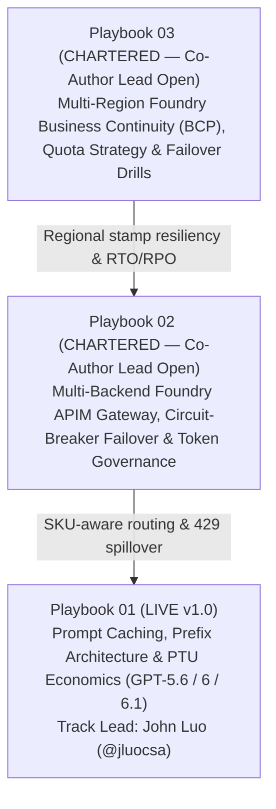

# Playbook Series Roadmap & Co-Author Charters

This hub is structured as a **three-part Enterprise Foundry Architecture Series**, where each playbook owns one layer of production readiness and is led by named specialist co-authors.

## Series Overview & Ownership Matrix

| Playbook | Status | Customer-Zero Provenance (Sanitized) | Track Lead / Co-Authors | Companion Assets |
| :--- | :--- | :--- | :--- | :--- |
| **[01 · Prompt Caching & PTU Readiness on GPT-5.6+](/playbooks/prompt-caching/start/01-executive-thesis)** | **Live `v1.0`** | Enterprise stateless multi-node document review & rubric-scoring platform | **Lead:** John Luo (`@jluocsa`) *Open to domain co-authors* | 16-page PDF white paper, interactive PTU/shard calculator, `PCR001–006` rules, KQL gate |
| **02 · Multi-Backend Foundry APIM Gateway & Spillover** | **Chartered (`v0.1` intake)** | Multi-region enterprise GenAI gateway fronting pooled Foundry accounts & PTU/PAYG tiers | **Co-Author Track Lead: Open for CSA Nomination** *(Advisor: `@jluocsa`)* | Bicep gateway patterns, native `Retry-After` circuit-breaker policies, SSE streaming guards |
| **03 · Multi-Region Foundry BCP & Failover Drills** | **Chartered (`v0.1` intake)** | Regulated enterprise business-continuity architecture across paired & non-paired regions | **Co-Author Track Lead: Open for CSA Nomination** *(Advisor: `@jluocsa`)* | Data Zone vs. Regional PTU matrix, failover runbook, synthetic health probes |

---

## Playbook 02 · Multi-Backend Foundry APIM Gateway & Spillover {#playbook-02-multi-backend-foundry-apim-gateway-spillover}

- **Problem Statement:** Enterprise platforms fronting multiple Microsoft Foundry accounts across `/openai/v1/responses` and `/openai/v1/chat/completions` need deterministic alias routing, managed-identity authentication, same-resource deployment failover, cross-account backend pool circuit breakers honoring `Retry-After`, and safe SSE streaming—without replaying non-idempotent failures or forwarding invalid SKU parameters (such as GPT-5.6 breakpoints onto PTU-M).
- **Planned 6-Stage Outline:**
  1. `Start`: Gateway patterns (single-account vs. deployment failover vs. multi-account backend pool).
  2. `Qualify`: Throughput, body-size limits, streaming timeout budgets, and gateway instance scaling.
  3. `Design`: Native APIM backend pool circuit breakers, SKU parameter stripping (`5.6 PTU-M` vs. `Standard`), and managed identity RBAC.
  4. `Validate`: Controlled HTTP `429` injection, `Retry-After` recovery verification, and SSE mid-stream failure safety.
  5. `Govern`: Metadata-only token accounting, per-tenant quota policies, and subscription-key isolation.
  6. `Reference`: Sanitized Bicep/policy reference lab + official Azure Architecture Center sources.
- **Co-Author Scope:** Own chapters 01–06 extraction from validated APIM gateway patterns, pass the 3-gate sanitization/ARB checklist, and co-publish the companion white paper.

---

## Playbook 03 · Multi-Region Foundry BCP & Failover Drills {#playbook-03-multi-region-foundry-bcp-failover-drills}

- **Problem Statement:** Regulated workloads running Provisioned Throughput (PTU-M) face strict data-residency boundaries (Global vs. Data Zone vs. Regional Provisioned), independent regional capacity pools, and stateful dependencies (Cosmos DB checkpoints, AI Search indexes, APIM gateways) that must fail over cohesively within agreed RTO/RPO targets.
- **Planned 6-Stage Outline:**
  1. `Start`: Data-processing vs. data-at-rest boundaries across Global, Data Zone, and Regional PTU-M.
  2. `Qualify`: Tiered criticality scorecard and cost trade-offs (active-active PTU reservations vs. active-passive PTU + PAYG standby).
  3. `Design`: End-to-end stamp resiliency across APIM, Foundry deployments, session state stores, and search indexes.
  4. `Validate`: Game-day failover drill protocol (synthetic `429`/`5xx` injection, circuit-breaker trip time, cache warm-up surge modeling).
  5. `Govern`: Drift detection on model snapshot versions, quota parity checks, and executive BCP sign-off criteria.
  6. `Reference`: Failover runbook template + Well-Architected AI reliability sources.
- **Co-Author Scope:** Lead extraction of sanitized BCP delivery patterns into the 6-stage playbook and 3-week readiness engagement kit.

::: info Interested in Co-Owning Track 02 or Track 03?
Review [`CONTRIBUTING.md`](https://github.com/jluocsa/azure-ai-playbooks/blob/main/CONTRIBUTING.md) for the 3-gate pre-publication workflow (Sanitization &rarr; Peer Architecture Review &rarr; IP/Channel Disposition). Co-authors receive full frontmatter and PDF cover attribution and own their track directory via `.github/CODEOWNERS`.
:::
